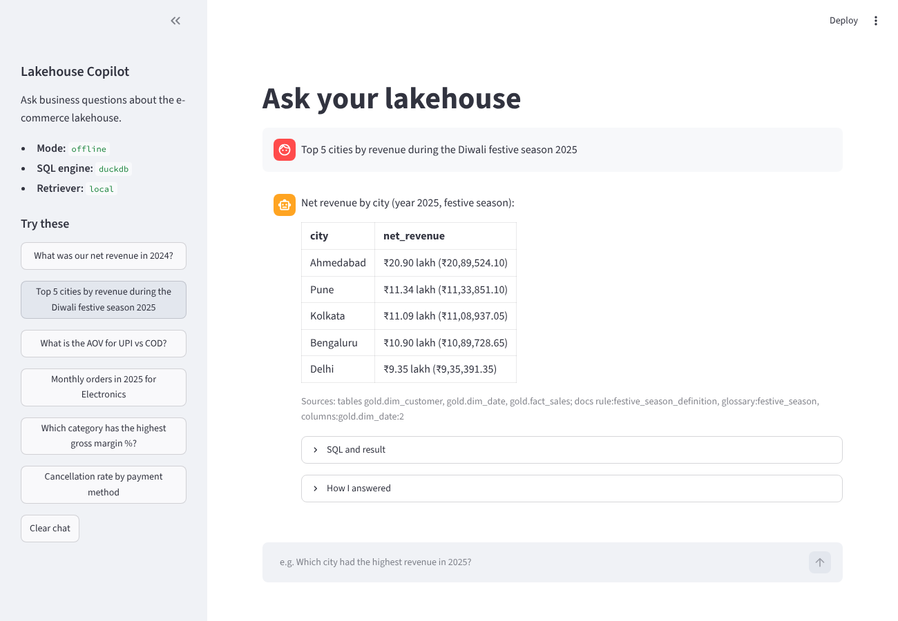
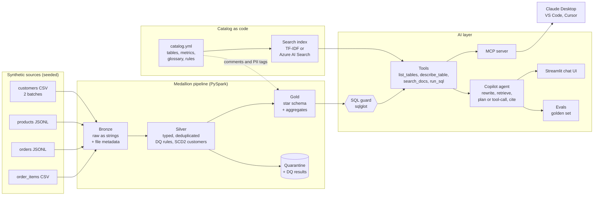

# Lakehouse Copilot (MCP + RAG)

[](https://github.com/rapuriteja/lakehouse-copilot-mcp/actions/workflows/ci.yml)

Ask business questions about a data lakehouse in plain English and get correct, cited answers.

**Lakehouse Copilot** is two things built together:

1. **A production-style data platform**: a PySpark medallion pipeline (Bronze, Silver, Gold) with
   data quality rules, quarantine tables, SCD Type 2 history and a star schema. It runs on
   Databricks with Delta Lake and Unity Catalog, and locally with Parquet.
2. **An AI layer on top of it**: a governed catalog indexed for RAG, an **MCP server** that lets
   any AI client (Claude Desktop, VS Code, Cursor) explore and query the Gold layer safely, and a
   copilot agent with a chat UI that writes the SQL, runs it and cites its sources.

Everything runs **free on a laptop** (local Spark, DuckDB, TF-IDF search). Switching to Azure is a
change in `.env`, not in code.



## The problem

Business users ask simple questions like *"What was our revenue during Diwali?"* and wait days
for an answer, because only a few engineers know which table to use, which orders count as
revenue and how a customer who moved city should be counted. General AI chatbots answer quickly
but invent table names and numbers.

This project closes that gap:

- **Trustworthy data first.** Bad records are caught and quarantined, history is kept with SCD2,
  and metric definitions live in one catalog file, not in people's heads.
- **AI that is grounded and safe.** The copilot only reads the governed Gold layer, through a
  read-only SQL guard that blocks writes, other layers and personal data (PII). Every answer
  cites the tables it actually queried and the catalog docs it used.
- **Measured, not assumed.** A golden question set measures retrieval quality and text-to-SQL
  accuracy, with a held-out test split.

## Architecture



| Layer | Local (free) | Azure |
|---|---|---|
| Storage | Parquet files in `lakehouse/` | ADLS Gen2 + Delta Lake, Unity Catalog |
| Compute | Local PySpark 4 | Databricks job (Asset Bundle), DBR 17.3 |
| Query engine for the copilot | DuckDB (read-only, PII columns left out) | Databricks SQL warehouse |
| Catalog search | TF-IDF (scikit-learn) | Azure AI Search: hybrid BM25 + vector + semantic ranker |
| Embeddings | none, or OpenRouter / sentence-transformers for `RETRIEVER=hybrid` | OpenRouter `openai/text-embedding-3-small` |
| Copilot brain | OpenRouter tool calling, or the offline semantic planner (rules, no LLM) when no key is set | OpenRouter tool calling (key read from Key Vault) |
| Secrets | `.env` (git-ignored) | Key Vault (OpenRouter and AI Search keys) |
| Monitoring | JSON run reports | Log Analytics + Application Insights |

## What is inside

### 1. Data (synthetic Indian e-commerce)

`lhc generate` creates two years (2024 and 2025) of orders for 2,000 customers in 30 Indian
cities and 250 products in 7 categories, with a Diwali sales spike, UPI/COD/card payments and
city tiers. The seed is fixed (`SEED=42`), so every run produces the same data.

It also creates **realistic problems on purpose**, so the pipeline has something to catch:
155 duplicate orders, 62 orders with no customer, 46 orders for unknown customers, 31 invalid
payment methods, 99 order lines with zero or negative quantity, 49 lines for unknown products,
malformed emails, and dates in two formats. A second customer batch (1 July 2025) has 70
customers who moved city, 29 who were upgraded to Premium, 8 email changes, 36 unchanged rows and
213 new customers.

### 2. Medallion pipeline (PySpark)

| Layer | What happens |
|---|---|
| **Bronze** | Read every source as strings (nothing can fail to parse) and add the source file, batch id and ingest time. |
| **Silver** | Cast types safely (`try_cast`, two date formats), normalise messy values (`upi`, `Cash on Delivery` → `UPI`, `COD`), remove duplicates with `row_number`, and apply **data quality rules** written as SQL expressions. Failing rows go to `quarantine_*` tables with the rule name; warnings are counted. Customers become an **SCD Type 2** table. |
| **Gold** | A star schema: `fact_sales` (one row per order line) with `dim_customer` (SCD2), `dim_product` and `dim_date` (Diwali season flagged), plus three aggregate tables. |

Key design choices:

- **SCD2 as a pure function.** `apply_scd2(current, incoming)` returns the new history. Tracked
  columns (city, segment) create a new version; Type 1 columns (email, phone) are overwritten on
  every version. Unchanged rows create nothing. Validity is a half-open interval
  `[effective_from, effective_to)`.
- **Point-in-time join.** A fact row joins to the customer version that was valid on the order
  date, so a customer who moved from Pune to Chennai in July 2025 counts in Pune before and in
  Chennai after.
- **Unknown members.** Every dimension has a `-1` row, so a fact row can never silently disappear
  in an inner join.
- **Deterministic surrogate keys** (`xxhash64` of the natural key), so re-running gives the same
  keys.
- **Same code, two targets.** `Lakehouse.write()` writes Parquet locally or a Delta table in
  Unity Catalog (`catalog.layer.table`) on Databricks.

The pipeline is verified against the generator's own manifest: every dirty record the generator
injected is caught by exactly the rule meant to catch it.

| Real run (local laptop, `local[2]`) | Rows |
|---|---|
| Bronze: customers / products / orders / order_items | 2,155 / 254 / 31,083 / 49,524 |
| Silver: orders / order_items | 30,789 / 48,947 |
| Quarantine: customers / orders / order_items | 3 / 139 / 380 |
| `silver.customers_scd2` | 2,099 versions for 2,000 customers |
| `gold.fact_sales` | 48,947 |
| Full pipeline time | 29 s |

### 3. Catalog as code + RAG

[`catalog.yml`](src/lakehouse_copilot/catalog/catalog.yml) is the single source of truth: every
Gold table and column (with a `pii` flag), 15 business metrics with their exact SQL, 9 glossary
terms and 5 business rules (for example *"revenue counts only Delivered and Shipped orders"*).

From it the project generates:

- [`docs/catalog.md`](docs/catalog.md), human-readable docs;
- 52 search chunks (one per table, column group, metric, term and rule) for RAG;
- on Databricks, Unity Catalog **table and column comments** and **`pii` tags**.

Search runs in one of three ways:

- `RETRIEVER=local`: TF-IDF keyword search, free and offline (the default);
- `RETRIEVER=hybrid`: TF-IDF plus vector search on embeddings, merged with Reciprocal Rank Fusion,
  on your laptop (embeddings from OpenRouter, or a free local sentence-transformers model);
- `RETRIEVER=azure`: **Azure AI Search** hybrid retrieval (BM25 + vectors with RRF) plus the
  semantic ranker, with embeddings from OpenRouter.

### 4. MCP server

An [MCP](https://modelcontextprotocol.io) server (Python MCP SDK v2, `MCPServer`) exposes four
read-only tools to any MCP client:

| Tool | What it does |
|---|---|
| `list_tables` | Gold tables with description and grain |
| `describe_table` | Columns, types, keys, joins (PII columns hidden) |
| `search_docs` | Search the catalog: metrics, glossary, rules |
| `run_sql` | Run one validated, read-only SELECT on Gold |

`run_sql` is protected in layers (**defence in depth**):

1. **SQL guard** ([`sql/guard.py`](src/lakehouse_copilot/sql/guard.py)) parses the SQL with
   `sqlglot` and allows exactly one `SELECT`, only `gold.*` tables, no PII columns, no `SELECT *`
   on a table with PII, no file-reading functions, and always adds a `LIMIT`.
2. **Read-only engine.** DuckDB opens the serving file read-only with external access disabled
   and a query timeout. PII columns are not even copied into it.
3. **Clear errors.** A rejected query returns the reason to the model, so it can fix its SQL.

```text
$ lhc sql "SELECT email FROM gold.dim_customer"
Query rejected: Column email is personal data (PII) and is blocked.
$ lhc sql "DROP TABLE gold.fact_sales"
Query rejected: Only SELECT queries are allowed, got DROP.
$ lhc sql "SELECT * FROM silver.orders"
Query rejected: Table silver.orders is not allowed. Allowed tables: gold.agg_daily_sales, ...
```

### 5. Copilot agent + chat UI

For every question the copilot:

1. **rewrites** the question into a better search query (synonyms such as AOV → average order
   value; follow-ups like *"and in 2025?"* are merged with the previous question);
2. **retrieves** the relevant catalog docs;
3. **answers**, in one of two modes:
   - **LLM mode** (OpenRouter by default; Azure OpenAI or any OpenAI-compatible server also
     work): the model calls the tools in a
     loop. SQL errors go back to it so it can correct itself, with a step limit.
   - **Offline mode** (default, free): a rule-based **semantic layer** maps the question to
     metrics, dimensions and filters and writes the SQL. It reads real dimension values (city
     names, categories) from the data, so it does not need hard-coded lists.
4. **cites** the tables the SQL actually read and the docs it used. Citations are built by code
   from real tool calls, never written by the model.

Numbers use Indian formatting (₹12.73 crore, ₹20.90 lakh). The Streamlit UI shows the answer, the
SQL, the result table and a "How I answered" trace.

## Evaluation results

A golden set of 40 questions ([`golden.yaml`](src/lakehouse_copilot/evals/golden.yaml)), each with
the catalog doc that should be found and a gold SQL query. **Dev** (20) was used while building;
**test** (20) was written separately and only run at the end, with no tuning on it.

Results from `lhc eval` (offline copilot, TF-IDF retriever, DuckDB), full report in
[`evals/results/eval_offline.md`](evals/results/eval_offline.md):

**Text-to-SQL execution accuracy** (the copilot's SQL returns the same rows as the gold SQL):

| Split | Correct | Accuracy |
|---|---|---|
| dev | 20/20 | 100% |
| test (held out) | 16/20 | **80%** |
| all | 36/40 | 90% |

**Retrieval** (is the right catalog doc found?):

| Split | Query | Hit@1 | Hit@3 | Hit@5 | MRR@5 |
|---|---|---|---|---|---|
| test | raw question | 0.85 | 0.90 | 0.95 | 0.89 |
| test | rewritten | 0.85 | 0.95 | **1.00** | **0.91** |
| all | rewritten | 0.85 | 0.93 | 1.00 | 0.91 |

Median time per question: about 0.01 s (offline mode, no LLM).

The 4 held-out failures are analysed in [`evals/README.md`](evals/README.md). All four are
wording the rule-based planner had not seen: "after discounts" matched the discount metric,
"share of COD orders that got cancelled" is not a known phrase for cancellation rate, "five"
written as a word was not read as a number, and "Diwali day" was read as "group by day". They were
left unfixed so the test score stays honest. Unseen wording is exactly what LLM mode is for.

### LLM mode (OpenRouter)

`lhc bench` ran three cheap OpenRouter models that support tool calling through the same agent,
tools and retriever (hybrid: TF-IDF + OpenRouter embeddings) on the same 40 questions. Full
table and analysis in [`evals/README.md`](evals/README.md#llm-mode-and-model-choice-openrouter).

| Model | Test (held out) | All 40 | Cost per run | Median latency |
|---|---|---|---|---|
| offline planner (no LLM) | 16/20 (80%) | 36/40 (90%) | free | 0.39 s |
| `openai/gpt-4o-mini` | 9/20 (45%) | 22/40 (55%) | $0.025 | 5.6 s |
| **`google/gemini-2.5-flash` (chosen)** | **17/20 (85%)** | 34/40 (85%) | $0.044 | 3.1 s |
| `deepseek/deepseek-chat` | 15/20 (75%) | 32/40 (80%) | $0.049 | 7.6 s |

`lhc eval` with the chosen model then scored **17/20 (85%) on held-out questions** (offline
planner: 80%) and 35/40 overall, for $0.045 for the whole 40-question run (about $0.001 per
question). LLM mode answered all four questions the offline planner got wrong. Its own misses
were mostly counting cancelled orders as orders and guessing a filter value. Scores move a little
between runs, since LLM output is not fully repeatable.

Hybrid retrieval with OpenRouter embeddings raised held-out MRR@5 from 0.91 to 0.96.

## Sample questions and answers

Real output from `lhc ask` (offline mode, seed 42):

**"What was the net revenue in 2024 vs 2025?"**

| year | net_revenue |
|---|---|
| 2024 | ₹12.73 crore (₹12,73,33,616.50) |
| 2025 | ₹15.37 crore (₹15,37,00,303.45) |

Sources: tables gold.dim_date, gold.fact_sales; docs metric:net_revenue, rule:revenue_recognition

**"Top 5 cities by revenue during the Diwali festive season 2025"**

| city | net_revenue |
|---|---|
| Ahmedabad | ₹20.90 lakh |
| Pune | ₹11.34 lakh |
| Kolkata | ₹11.09 lakh |
| Bengaluru | ₹10.90 lakh |
| Delhi | ₹9.35 lakh |

Sources: tables gold.dim_customer, gold.dim_date, gold.fact_sales; docs rule:festive_season_definition, glossary:festive_season

```sql
SELECT c.city AS city, ROUND(SUM(CASE WHEN f.is_revenue THEN f.net_amount END), 2) AS net_revenue
FROM gold.fact_sales AS f
JOIN gold.dim_date AS d ON f.date_key = d.date_key
JOIN gold.dim_customer AS c ON f.customer_sk = c.customer_sk
WHERE d.year = 2025 AND d.is_festive_season = TRUE
GROUP BY 1 ORDER BY net_revenue DESC LIMIT 5
```

**"What is the cancellation rate by payment method?"**

| payment_method | cancellation_rate |
|---|---|
| COD | 14.32% |
| Debit Card | 8.64% |
| UPI | 8.35% |
| Net Banking | 8.22% |
| Credit Card | 8.11% |
| Wallet | 8.01% |

Sources: tables gold.fact_sales; docs metric:cancellation_rate, glossary:cod

**"How many customers placed an order in Chennai?"** → Active customers (city Chennai): 118.
Sources: tables gold.dim_customer, gold.fact_sales; docs metric:active_customers, rule:customer_city_history

## Tech stack

| Area | Tools |
|---|---|
| Data engineering | PySpark 4, Delta Lake, Unity Catalog, Databricks Asset Bundles, DuckDB, Parquet |
| AI | Model Context Protocol (Python SDK v2), OpenRouter through the OpenAI SDK (tool calling, embeddings), Azure AI Search (hybrid + semantic ranker), scikit-learn TF-IDF, sqlglot |
| App | Streamlit, command-line tool `lhc` (argparse) |
| Infrastructure | Terraform (azurerm 4.x): ADLS Gen2, Databricks, Key Vault, AI Search, Log Analytics, Application Insights (Azure OpenAI optional, off by default) |
| CI/CD and quality | GitHub Actions (OIDC deploy), pytest (138 tests), ruff, pydantic-settings |

## Run it locally (free, no cloud account)

Needs Python 3.10+ and Java 17+ (for Spark).

```bash
git clone https://github.com/rapuriteja/lakehouse-copilot-mcp.git
cd lakehouse-copilot-mcp
python -m venv .venv && source .venv/bin/activate
pip install -e ".[dev]"
cp .env.example .env          # defaults are local and free

lhc generate                  # synthetic data -> data/raw
lhc pipeline                  # bronze -> silver -> gold (+ serving DB for the copilot)
lhc index                     # catalog docs + search index
lhc ask "Top 5 cities by revenue during the festive season" -v
lhc ui                        # chat UI at http://localhost:8501
lhc eval                      # golden-set evaluation -> evals/results/
pytest                        # 138 tests, no cloud keys needed
```

The whole flow (generate, pipeline, index, eval) takes about 50 seconds on a laptop.

### Use the MCP server from Claude Desktop, VS Code or Cursor

```bash
lhc mcp                       # stdio (for desktop clients)
lhc mcp --http --port 8000    # streamable HTTP
```

Add it to your client with [`examples/mcp_client_config.json`](examples/mcp_client_config.json)
(set the two absolute paths). Then ask the client, for example, *"Using the lakehouse tools,
which category had the best gross margin in 2025?"*

### Use a real LLM (OpenRouter)

[OpenRouter](https://openrouter.ai) is one API in front of many models (OpenAI, Google,
DeepSeek and more). The copilot uses it through the official OpenAI Python SDK. Put your key in
`.env` (git-ignored) and nothing else needs to change:

```bash
OPENROUTER_API_KEY=<your key>
LLM_MODEL=google/gemini-2.5-flash  # any OpenRouter model id that supports tool calling
```

Without a key the copilot runs in offline mode, so tests and CI never need one. Other options:
`LLM_BASE_URL` points at any OpenAI-compatible server (for example a local Ollama), and
`LLM_PROVIDER=azure` uses Azure OpenAI instead.

```bash
lhc ask "Top 3 brands in Fashion by revenue" -v     # shows SQL, LLM calls, tokens and cost
lhc eval --model google/gemini-2.5-flash              # LLM-mode accuracy on the golden set
lhc bench --models openai/gpt-4o-mini,google/gemini-2.5-flash,deepseek/deepseek-chat
```

### Check for secrets before pushing

```bash
python scripts/scan_secrets.py   # working tree + full git history; also runs in CI
```

## Deploy to Azure

> Deploying creates paid resources (Databricks compute). AI Search uses the free tier and the
> LLM is paid per use on OpenRouter. Run `terraform destroy` when you are done.

**[AZURE_SETUP.md](AZURE_SETUP.md) is a step-by-step guide** (az login, Terraform, Unity Catalog,
the Key Vault-backed secret scope, the bundle deploy, testing, costs and clean-up). In short:

1. **Terraform** (`infra/terraform`) creates a resource group, ADLS Gen2 (`landing` and
   `lakehouse` containers, shared keys disabled), a Databricks premium workspace with an access
   connector, Key Vault (RBAC) holding the OpenRouter and AI Search keys, AI Search (free tier,
   semantic ranker) and Log Analytics + Application Insights. The OpenRouter key is passed as
   `TF_VAR_openrouter_api_key`, never written in a file. Azure OpenAI is optional
   (`enable_azure_openai = true`) and off by default.
2. **Unity Catalog**: a storage credential from the access connector, an external location and
   the `lakehouse_copilot` catalog (one time).
3. **Secret scope**: a Key Vault-backed Databricks secret scope named `lakehouse-copilot`, so jobs
   read the keys from Key Vault.
4. **Databricks Asset Bundle**: `databricks bundle deploy -t dev`, then run the job
   `generate_data → bronze → silver → gold → publish_docs → index_search`. `publish_docs`
   writes catalog descriptions as Unity Catalog comments and PII tags; `index_search` embeds the
   catalog docs through OpenRouter and uploads them to Azure AI Search.
5. **Point the copilot at Azure** with `terraform output env_file_hint`. The app reads missing keys
   from Key Vault (`KEY_VAULT_URI`) with your `az login`.

**CI/CD.** [`ci.yml`](.github/workflows/ci.yml) runs on every push: ruff, the secret scan over the
full history, pytest on Python 3.10 and 3.13, the full local pipeline with evals (the report is
uploaded as an artifact), and `terraform validate`. No key is needed. [`deploy.yml`](.github/workflows/deploy.yml)
is started by hand: it logs in to Azure with OIDC (no stored passwords), runs `terraform plan`
(and `apply` if chosen), then deploys the bundle. It needs the repository secrets
`AZURE_CLIENT_ID`, `AZURE_TENANT_ID`, `AZURE_SUBSCRIPTION_ID`, `TFSTATE_RESOURCE_GROUP`,
`TFSTATE_STORAGE_ACCOUNT`, `DATABRICKS_CLIENT_ID` and `OPENROUTER_API_KEY`, and the variable
`AZURE_DATABRICKS_SP_OBJECT_ID`.

## Project layout

```text
src/lakehouse_copilot/
  data_gen/      synthetic data generator (seeded, with dirty records)
  pipeline/      bronze, silver (DQ, SCD2), gold (star schema), storage, run
  catalog/       catalog.yml (single source of truth), model, docs and chunks
  rag/           TF-IDF, local hybrid and Azure AI Search retrievers, embeddings
  sql/           SQL guard (sqlglot) and query engines (DuckDB, Databricks)
  tools.py       the four tools shared by the MCP server and the agent
  mcp_server/    MCP server
  agent/         query rewriting, semantic planner, LLM tool loop, formatting
  app/           Streamlit chat UI
  evals/         golden set, metrics, runner
  databricks_job.py  entry point for the Databricks job tasks
scripts/         scan_secrets.py (run before every push)
infra/terraform/ Azure infrastructure
resources/       Databricks Asset Bundle resources (schemas, volume, job)
tests/           138 tests (pipeline, SCD2, DQ, guard, MCP, agent, UI, evals, secrets)
```

## Limitations and next steps

- LLM mode (Gemini 2.5 Flash) is only 5 points above the offline planner on 20 held-out
  questions; a bigger golden set is needed to tell close models apart with confidence.
- The Azure paths (AI Search, Key Vault, Databricks SQL) are covered by tests with fakes and
  `terraform validate`; they have not been deployed from this repository yet.
- The offline planner handles common metric, filter and group-by questions, not nested logic.
- Next: incremental (streaming) ingestion with Auto Loader, DQ expectations in Lakeflow
  Declarative Pipelines, and a cost dashboard from the Log Analytics data.

To learn how each part works, and for interview practice, read [LEARN.md](LEARN.md).

## License

MIT © Rapuri Teja
